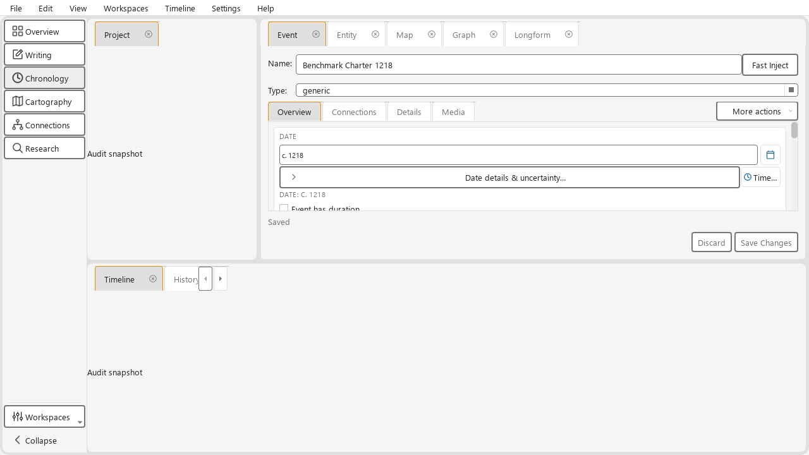
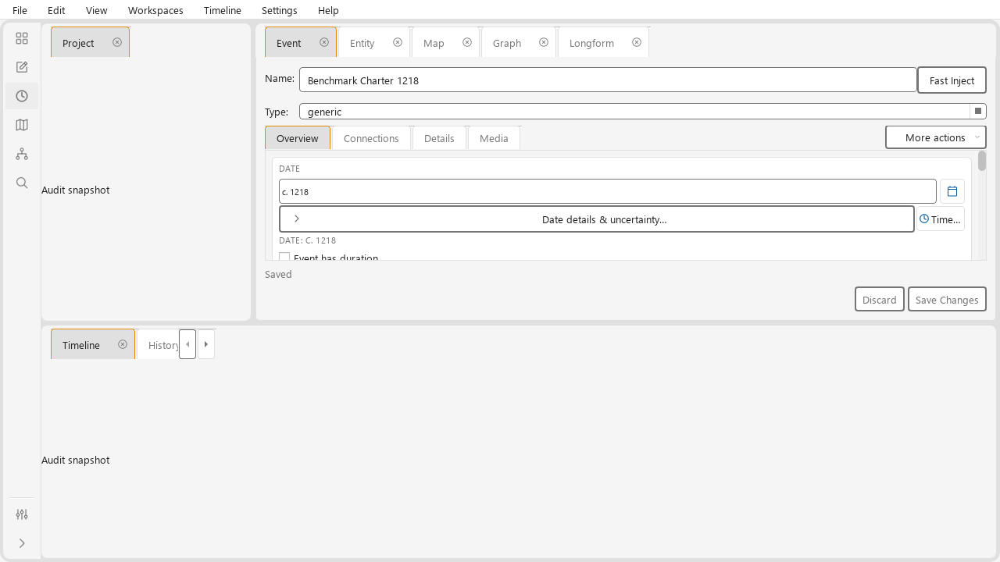
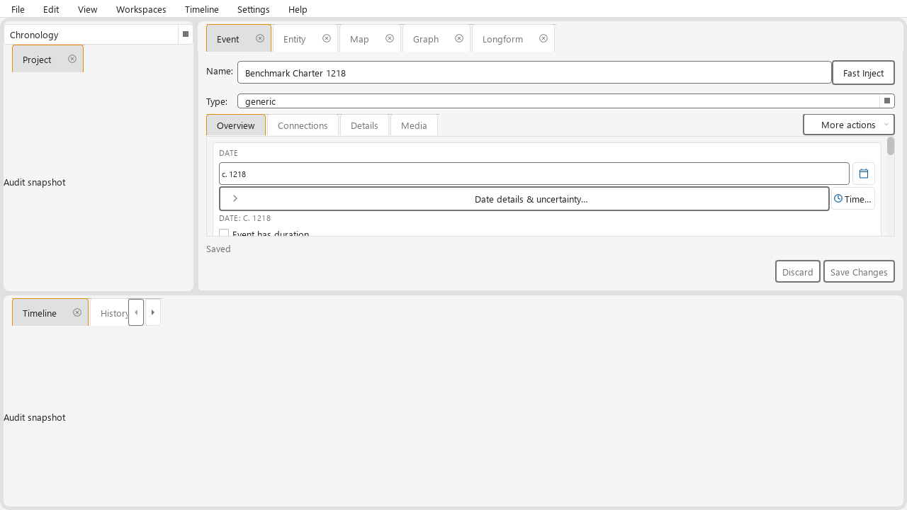
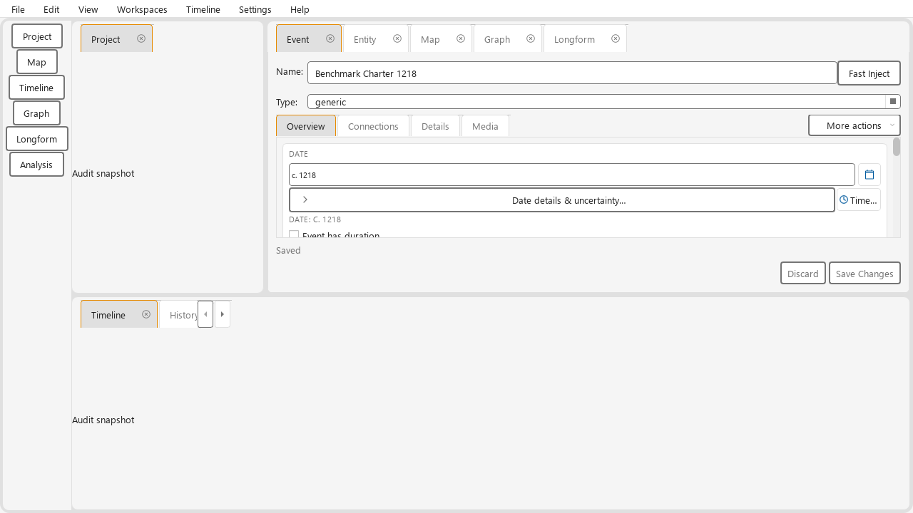

# KRT-108 activity workspace implementation evidence

Date: 2026-10-24. Base revision: `cc1b98ea1a57329d537d9080438f63499ddadede`.
The owner authorized a local delivery commit using the recorded passing tests;
its hash is recorded in KRT-108. Native Windows review, participant task comparison
and human documentation approval remain pending.

## Behavior and boundaries

The six activities replace panel-launcher buttons. Workspaces are saved layouts;
individual tools remain under View → Panels. Custom entries live in the Workspaces
menu, which is also available in the menu bar. The menu-bar destination retains its
full name independently of the rail icon. Built-ins cannot be renamed or deleted.

`WorkspaceCoordinator` receives narrow layout/selection/presentation endpoints,
not MainWindow or database services. `WorkspaceStore` persists machine-local
layout-version-2 snapshots inside a version-1 collection. Legacy current/named
layouts migrate once without deleting recovery values. Local workspace reset
retains custom named resources. Unknown panels and malformed entries recover
independently; a damaged custom layout can recover from its creation baseline.

Switching preserves existing widgets and documents. Final visible panels activate
after the complete layout is applied; intermediate Graph/Longform hydration is
suppressed. Focus writing exits its temporary presentation. Startup does not save
provisional pre-show splitter widths. Custom tab-close controls leave keyboard
traversal while outside the visible tab strip or covered by its scroll arrows;
scrolling or View → Panels retains the close route.

## Variant assessment

The owner chose the six-activity rail and custom workspace management, with Writing
foregrounding the current inspector. The selector is a comparison-only prototype
in `scripts/capture_workspace_evidence.py`; it is not production navigation.

| Variant | Source/render observation | Decision |
| --- | --- | --- |
| Previous panel rail | Reveals a panel tab; does not switch or automatically retain activity layouts. Reconstructed for visual comparison only. | Replaced. |
| Expanded activity rail | Six labeled direct destinations; 137 px in the Segoe UI 10 pt, 1280×720 fixture. Workspaces manages custom entries. | Chosen by owner. |
| Collapsed activity rail | Default state: smaller, muted icons, borderless quiet controls, names in tooltips and the Workspaces menu. Width includes toolbar chrome around the 44 px target. | Owner requested and accepted the icon-only convention on 2026-10-24; native scaling review remains pending. |
| Selector above Project | Reclaims the rail width, but pointer selection ordinarily requires opening a list and choosing an entry. The selector disappears with the Project zone. | Not shipped; assessment is an interaction-cost inference, not measured participant superiority. |

The captures use inert presenters and an isolated fixture Event, not a personal
world. Each variant starts from the same reset Chronology layout. The full capture
manifest records requested/actual size, font, device ratio and physical dimensions
under `artifacts/krt108/rendered/`. No participant timing, hesitation or learning
claim is established by these images.

The automated task route covers Event editing with Timeline → Writing → open Map
through the panel route → Chronology → customize → switch away/back → reload local
settings → reset. Real Entity/Event editor tests retain dirty text, document
identity, selected object, caret, scroll and undo across switches and Focus writing
exit. A real Longform view retains text selection and scroll through cached
hydration. Map draft/playhead sentinel tests protect the no-mutation boundary;
native map/journey workflows remain part of the pending live review.

## Automated verification

| Check | Result and retained artifact |
| --- | --- |
| `pytest -m ci_fast -q` | Final run: 2,548 passed, 3 skipped; `artifacts/krt108/ci-fast-final.log`. |
| Focused workspace/editor/Help/dependency/settings checks | 179 passed, 1 skipped; `artifacts/krt108/focused.log`. Final numeric-corruption and assistance-focus additions are covered separately by 25 passing workspace tests in `workspace-tests.log`. |
| Full ActivityBar label matrix | 1,920 records, zero failures across six palettes, four simulated display scales and four independent text scales, including expanded/collapsed, disabled and expanded-wording cases; `artifacts/krt108/navigation-final/`. |
| Integrated WorkspaceShell label check | 12 records, zero failures at 1280/1600 widths and 100%/200% text size; `artifacts/krt108/workspace-final/`. |
| Ruff / mypy | Clean; repository-wide mypy checks 507 source files. |
| Visual / complexity policies | Pass; no complexity allowance or visual exception expansion. `artifacts/krt108/complexity.json` records unchanged reviewed hotspots. |
| SVG assets | Six new hand-authored icons parse as XML, use `currentColor` strokes and render in the captured palettes. Existing shared icons remain unchanged. |
| Help and manual | Inspection inventory, offline Help generation and strict Sphinx checked; rendered review and human boundaries below. |

Earlier failed/interrupted audit artifacts are retained in `action-labels/`,
`navigation-matrix/` and `workspace-labels/` for diagnosis. They are superseded by
the explicitly named final reports. The integrated tab-close failure was fixed
in the presentation path; no baseline was regenerated to conceal it.

## Contracts and documentation review

Contracts 2/5/6/7/8/9/11 apply. Secondary navigation uses shared StyleHelper action
states; collapse/expand and tab-close cues use the quiet role. Icons use neutral
theme text, not Entity/Event identity colors. F1 on the rail resolves
`workspace.navigation`; inspection resolves the activity/manage explanations
without activation or draft mutation. Description Tab semantics remain KRT-94.

Owner refinement, 2026-10-24: collapsed navigation is now the default. Existing
pre-refinement saved rail state adopts this default once; subsequent expansion
choices are remembered. Compact controls use a shared borderless quiet style,
18 px icons and the theme's supporting-caption color. Hover/checked fills and
keyboard focus remain visible. Expanded navigation retains its labels and
secondary control presentation. This is the owner's bounded presentation choice;
the broader native UX and DPI acceptance remains pending.

Refinement verification: 33 focused workspace/shared-action tests pass, as do
Ruff, repository-wide mypy, visual/complexity policies, the inspection inventory,
offline Help and strict Sphinx. Updated theme captures are retained in the
rendered artifact folder; the new navigation matrix is `navigation-refinement/`.

| Documentation review field | Record |
| --- | --- |
| Reader / purpose | Existing creators arranging tools; workspace.md is primarily a how-to guide. |
| Canonical pages / release | Workspace and getting-started guides; Unreleased after 0.20.1. |
| Behavior sources | WorkspaceCoordinator, WorkspaceStore, ActivityBar, WorkspaceShell, local reset adapter and focused regressions. |
| Starting state / acceptance | Open world; choose Workspaces, name and accept Save as workspace, switch away/back to verify. Reset/Delete require confirmation; Cancel preserves state. |
| Help destinations | `workspace.navigation`, existing task and legacy excerpt anchors retained; new `help-inspect-workspace-activity` and `help-inspect-workspace-manage`. Removed construction bindings correspond to retired Layouts commands. |
| Rendered review | Qt screenshots inspected for rail labels/icons, menu-bar wording, panel allocation and expanded/collapsed variants. Capture tooling records focus/hover/pressed/disabled examples in every palette. Chromium renders of the manual introduction/save procedure and real offline Help at 360/640 px in light/dark themes are retained under `artifacts/krt108/document-renders/`; the reproduction helper is `render_documents.py` in that artifact root. |
| Human prose / live Help approval | Pending. |
| Reader observation | Pending under the linked project reader-testing protocol; no fabricated newcomer sessions. |

Before acceptance, perform the task route above natively at normal/narrow sizes,
with clean/dirty inspectors, map drafts, closed/moved panels, custom layouts and
application restart. Review all supported Windows display/text scales, six themes,
hover/pressed/checked/disabled/focus states, popup return focus and F1.
Record task comparison with the selector separately from the
owner's direction choice. Automated simulated scales do not establish native
Windows DPI behavior or human usability. Keep KRT-108 open for the remaining
native and task-review evidence; local commit authorization does not establish it.
