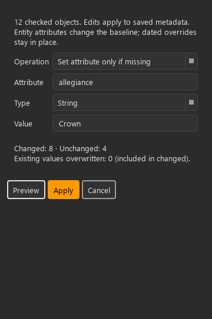
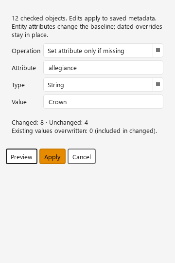
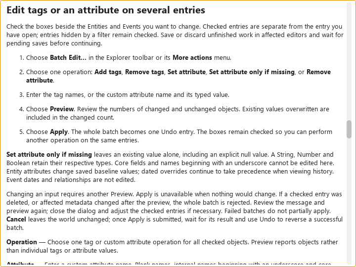

# KRT-127 batch metadata editing

Implementation evidence, 2026-11-01, branch `feat/batch-metadata`. Changes are
uncommitted; the issue remains In Progress. This work edits saved Entity/Event
metadata through one dedicated command and adds no schema or temporal mutation.

## Behavior and review

Explorer's checked identities supply the targets independently of single-row
navigation. One Apply adds/removes tags, sets one typed custom attribute, sets it
only if absent, or removes it. Preview distinguishes changed, unchanged and
overwritten objects. Existing null values count as present. Affected unsaved or
pending editor work blocks preview/Apply and remains in its original editor.

Worker-side comparison verifies the affected keys for every preview target,
including targets classified unchanged. Commands patch freshly loaded records,
preserve unrelated fields/internal metadata, synchronize normalized tag rows,
and emit one effect per changed object. Undo/redo use inverse/forward patches,
retaining exact original key absence. Conflicts and write failures roll back the
whole batch. The existing multi-object refresh/index path is reused; batch
undo/redo explicitly request indexing for every restored record.

Review also found an Explorer refresh issue: upserts hidden by its type filter
were passed to the model as removals, clearing checks. Such upserts now update
the backing cache without removing the hidden checked identity. Actual deletions
still remove their checks.

Authoring Contracts 2–9 and 11 apply. The multi-object modal follows Contract 3.
The existing toolbar/overflow is the visible entry route. Apply uses the primary
role; supporting controls use shared secondary presentation. Text explains the
baseline scope, prerequisites, counts and failures. Enter in tag input adds its
tag; form fields do not implicitly submit a batch. Escape cancels the local
dialog or completion first, except while an Apply is awaiting acknowledgement.
No contract revision or new presentation exception is introduced.

The shared wrapping selector, scrollable form and action-flow layout retain
wording at narrow widths. Normal navigation, checks, playhead and unrelated
drafts are preserved. A clean affected inspector is rehydrated without selecting
a different object. Temporal Entity views resolve again through their existing
hydration path; dated overrides are not edited.

## Automated and rendered evidence

The checkout interpreter is Python 3.13.14 with PySide6/Qt 6.10.1. Windows GUI
tests use `QT_QPA_PLATFORM=offscreen`. The restricted runner could not start the
interpreter; checks used the approved elevated runner with the same interpreter.

- Final consolidated suite: **196 passed, 1 skipped** in 27.86 s. This covers
  batch command/dialog/history, Explorer, production composition, architecture,
  dependency direction and Help generation/search. A subsequent stronger full
  label-fit assertion passed the theme/narrow matrix again.
- Repository-wide mypy: **588 source files clean**.
- Ruff, visual policy, complexity policy and Help inspection: passed.
- Strict Sphinx and offline Help build: passed.
- The Help topic test was updated to verify unique registered topic identities
  and resolution/search, replacing its obsolete fixed count of 50. The focused
  Help suite passed **22 tests, 1 skipped** after adding the Batch Edit topic.
- Initial broader `ci_fast`: **3,080 passed, 2 failed, 3 skipped** in 602.25 s.
  Failures were the fixed Help topic count and a forbidden direct database type
  import in the new app coordinator. The latter now uses the service-owned
  provider alias. Both corrections passed the final consolidated suite. The
  entire `ci_fast` suite was **not rerun** after these corrections; this is not
  evidence of a completely passing final `ci_fast` run.

Commands used the checkout `.venv/Scripts/python.exe`: `-m pytest` with the
above focused modules and `-m pytest -m ci_fast -q`; `-m ruff check`;
`-m mypy src`; `-m scripts.check_visual_policy`;
`-m scripts.check_complexity_policy`; `-m scripts.check_help_inspection`;
`-m scripts.check_test_policy`; `-m scripts.build_help`; and
`-m sphinx -n -W --keep-going -b html docs docs/_build/html`.

The dialog layout test covers all shipped themes, focus, disabled Apply and
preview states, widths 360/560, and local font factors 1/1.25/1.5/2. These are
offscreen geometry checks, not native Windows DPI acceptance.

The captures below were inspected after explicitly loading Windows Segoe UI
fonts. Initial offscreen fallback glyphs were unreadable and were replaced.
[Render metadata](render-metadata.json) records actual logical sizes, effective
font, device pixel ratio and physical capture sizes. Both dialog captures are
360 × 540 logical pixels at DPR 1.

## Documentation review and remaining acceptance

| Review-form field | Record |
| --- | --- |
| Reader and purpose | Existing authors editing multiple saved entries; how-to with control reference |
| Canonical page/release | Workspace manual, current 0.21 beta source checkout |
| Sources inspected | Batch dialog/coordinator/worker/service/command; Explorer; command, history and refresh tests |
| Help integration | New `explorer.batch-edit` topic and explicit control bindings; existing task meanings/anchors retained |
| Source identity | Uncommitted feature branch; reviewed Help AST fingerprints in the inspection inventory |
| Rendered review | Agent inspected the two themed narrow widgets and built Help screenshot above |
| Human prose/live Help review | Pending |
| Native Windows OS/text scaling matrix | Pending; offscreen local-font checks do not establish this |
| Reader round and measured usability | Pending; no participant observations or task-time claims |

Human approval and native scaling remain acceptance limits. No release/package
verification, commit or push is included in this implementation delivery.
