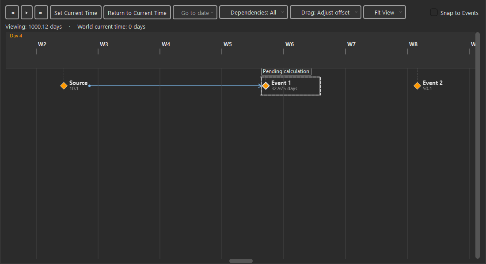
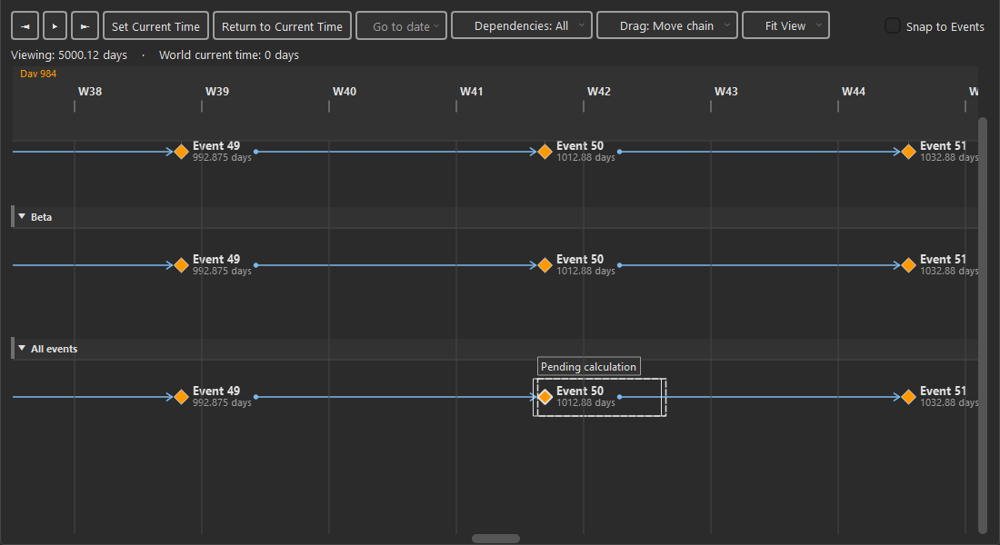
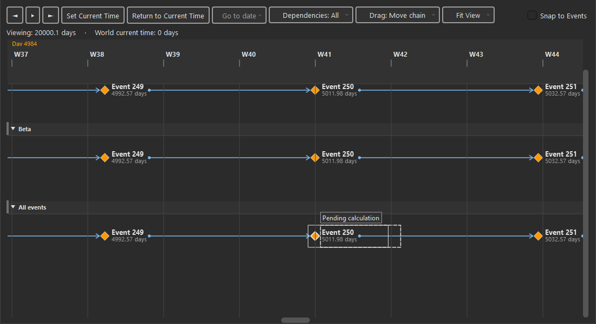
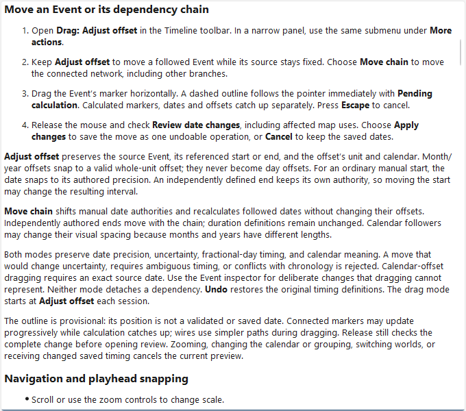

# KRT-130 — Responsive timeline drag previews

Performance follow-up to KRT-128, implemented locally on 2026-11-01. No gesture
changes, commit, push, package or release are included in this work.

## Changes and boundaries

The pointer moves a dashed **Pending calculation** outline immediately. A 33 ms
throttle sends the latest target to one persistent calculation worker. Continuous
motion neither restarts a debounce nor cancels useful work. There is at most one
calculation in flight and one pending target.

The worker parses immutable sources once per session and caches the complete
affected Event/chronology closure, baseline resolution and reference indexes.
Exact day-reference trees without chronology, uncertainty, independent ends or
calendar rules admit a rational translation fast path. Other timing uses the
existing solver over the complete component. Render deltas omit joint-model
identity and never authorize writes. Release still uses full-world validation,
consequence review, atomic application and exact Undo/Redo.

Only changed markers and their grouped copies are updated. Large results are
presented in short, yielding slices with latest-target replacement and fair queue
ordering. Item measurement is cached with snapshot, date/name, scale, calendar,
font and theme invalidation. A single application-font subscription avoids
per-item lifecycle callbacks. During dragging, unaffected wires keep cached paths;
affected wires use inexpensive cubic paths. Obstacle routing resumes afterward.

Source snapshots remain unchanged. Escape, stale generations, world changes,
calendar changes, zoom and grouping invalidate the session. Qt objects stay on
the GUI thread; the worker receives detached JSON and has no SQL or GUI dependency.

## Native Windows measurements

The reproducible harness is `tests/manual/krt130_drag_benchmark.py`.
[Raw measurements](native-benchmark.json) record Python/platform, all six fixtures,
60 continuous pointer updates per fixture, calculation/presentation/routing costs,
queue limits and unchanged source assertions. Each sample asserts that the marker
and outline are actually in the viewport; a preliminary offscreen-centering fixture
was discarded. Measurements are Qt input and paint dispatch, not compositor latency.

| World events | Component | Grouped copies | p95 input to outline paint | p95 frame interval | Previews before motion stops |
| --- | --- | --- | --- | --- | --- |
| 100 | 2 | No | 0.835 ms | 18.175 ms | 19 |
| 100 | 100 | Yes | 6.366 ms | 24.559 ms | 16 |
| 500 | 2 | No | 0.886 ms | 18.258 ms | 20 |
| 500 | 100 | Yes | 5.919 ms | 23.451 ms | 18 |
| 2,000 | 2 | No | 1.197 ms | 18.136 ms | 19 |
| 2,000 | 500 | Yes | 23.028 ms | 44.691 ms | 19 |

All six fixtures meet the **p95 below 33 ms** input-to-outline target. All use one
worker and at most one pending target, with **zero obstacle-routing calls during
the drag** and no preview errors. Adding unrelated events keeps the small component
at two events: its p95 calculation remains below 0.35 ms in this run.

The largest grouped fixture is **not constant 60 fps**: median frame interval is
26.008 ms and p95 is 44.691 ms. Its maximum input-to-paint sample is 52.695 ms.
These limits remain visible rather than being summarized as universal 60 fps.
The fixtures use stable layout, linear exact-day dependencies, visible wires and
disposable data/settings. They do not establish performance for every personal
world, uncertain/calendar-heavy network, background workload or packaged build.

During initial diagnosis, the old restarting timer produced zero previews during
60 continuous updates, followed by one after pausing. Its full-plan preview cost
was approximately 20 ms for 100 events and 97 ms for 500 events in a separate
synthetic probe. These are diagnostic observations, not a paired native FPS study.

## Visual and interaction evidence

Contracts **2/3/5/6/7/8/9** remain applicable. Toolbar modes and keyboard access
are unchanged. The provisional outline uses `focus_ring`; its status uses neutral
`mode_bg`, `mode_border` and `mode_text`. Existing identity and selection roles
remain distinct. The live outline follows all six themes; focus/disabled/narrow
toolbar behavior retains the existing shared controls. No visual baseline
exceptions were added. Selection, Y placement, drafts, playhead and saved dates
remain independent of provisional presentation.

## Verification and documentation review

- Broad timeline/timing/history/shell/Help matrix: **781 passed, 1 existing skip**;
  one existing Qt mouse-constructor deprecation warning. The added preview
  dependency-boundary guard passed separately.
- Preview/full-plan parity covers day/month/year offsets, uncertainty, independent
  ends, chronology owners, exact fractional ranges, duration and date limits.
- Continuous-motion, one-pending-target, intermediate-result, Escape, stale-world,
  incremental-update, sliced-presentation fairness, geometry-cache invalidation,
  theme roles and no-routing-during-drag regressions pass.
- Ruff, changed-file formatting, full-source mypy (**597 files**), visual/complexity
  policies and Help inventory pass separately from native timing. Reviewed C901
  allowances remain untouched. Offline Help and strict Sphinx builds pass.
  A repository-wide format-only check also found pre-existing formatting debt in
  unrelated files; those files were left unchanged.

| Documentation review field | Record |
| --- | --- |
| Reader and task | Author moving an Event while distinguishing pending and calculated timing |
| Primary purpose | Existing Timeline how-to and contextual control reference |
| Canonical page / release | Timeline and calendars / Unreleased |
| Source identity | Uncommitted KRT-130 worktree; native measurements use disposable fixtures |
| Sources verified | Presenter, persistent coordinator/worker, component/translation preview and unchanged full apply pipeline |
| Help routes | Existing `timeline.viewing` task and drag-mode anchor retained |
| Procedure | Drag, observe pending outline and calculated markers, release, review and Apply or Cancel |
| Rendered review | Agent inspected the visible native offset/grouped captures; offline Help review recorded alongside its capture |
| Human prose/live Help approval | Pending |
| Reader performance testing | Pending; no independent usability or completion-time claim |

Review follows the [documentation review form](../../../developer/documentation-review.md)
and [reader-testing protocol](../../../developer/documentation-reader-testing.md).
