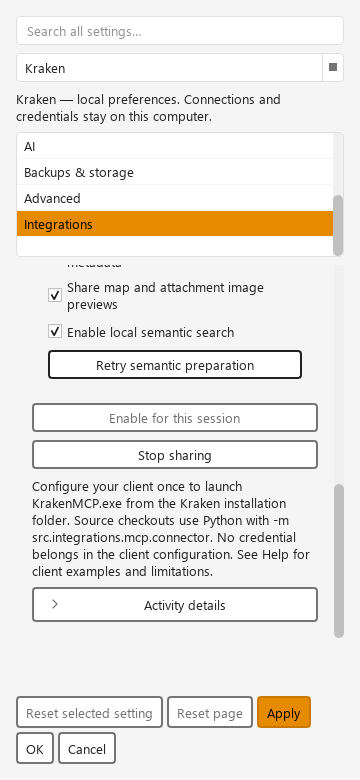
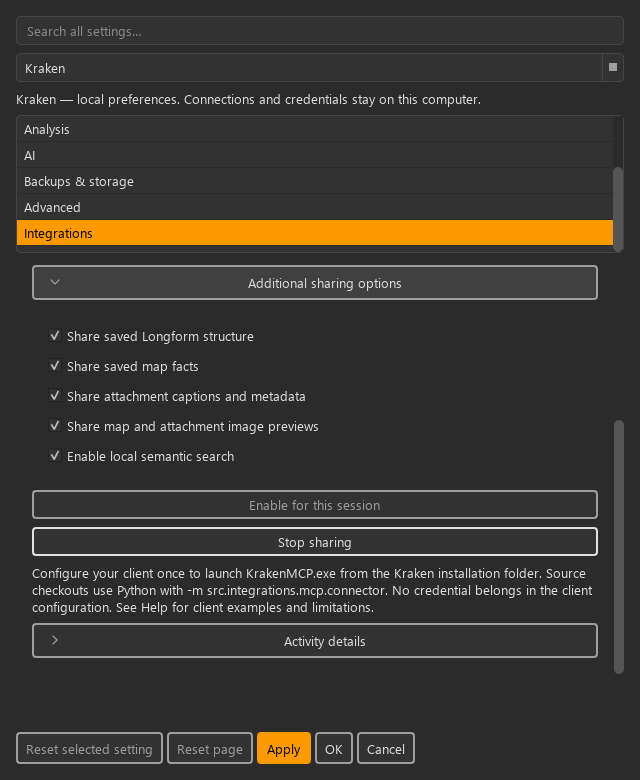
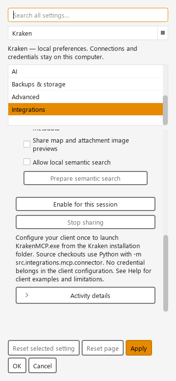
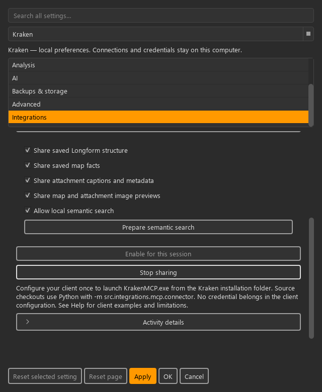

# KRT-139 richer MCP reads: verification and acceptance

Primary purpose: verification reference for maintainers. Related task:
[KRT-139](https://linear.app/projektkraken/issue/KRT-139/reliable-richer-mcp-reads-consistency-paging-scoped-world-content-and).
The existing KRT-119 evidence remains historical; it does not certify this extension.

## Automatic semantic preparation, 2026-11-08

Owner direction supersedes the earlier separate mandatory Prepare action. Enabling
sharing with the semantic scope selected automatically starts local preparation
after secure startup. Saved changes cancel stale work and debounce refresh for
300 ms; Stop/world switch cancels it. Preparation status carries its request ID
so an old callback cannot replace a newer preparation's state. An unavailable
model/preparation does not repeatedly retry; the form exposes **Retry semantic
preparation** only in that state. No download or external embedding provider is used.

**227 focused tests passed**, including startup/no-scope/failed-start checks,
debounced refresh, cancellation on Stop/world replacement, old callback rejection,
retry behavior and context-preserving Settings presentation. Ruff and mypy (638
source files), complexity, visual and Help inspection policies pass.

The [automatic preparation source check](automatic-semantic-connector.json) used
the installed offline model, observed exactly one preparation reach ready without
pressing a preparation button, then exercised all 20 tools in both SDK modes.
Its verification-only observer waits for readiness before starting client calls;
ordinary clients can receive labelled lexical fallback while preparation runs.
Protected discovery and the disposable world are isolated as in the follow-up below.

Presentation preserves authoring contracts 1/2/4/5/6/7/8/9: Settings keeps the local
opt-in and Stop routes, and exposes recovery only when needed. Shared neutral
secondary buttons, wrapping choices and disclosure roles retain focus/disabled
behavior without new colors or local variants. Authored drafts, selection, caret,
playhead, scroll and undo state are not changed. Six-theme offscreen renders cover
preparing/ready/unavailable, 360/640/960 widths and unavailable/off controls; narrow
light retry focus and dark ready controls were inspected. This is rendered and
automated evidence; independent human/native-DPI review remains pending.

The user guide retains existing Help anchors and now describes enable → automatic
preparation → ready, automatic refresh, and local retry recovery. The documentation
review form below remains applicable; no human approval or reader observations
are inferred from the source tests/builds. No new Windows package or independent
desktop-client acceptance is claimed for this uncommitted change.

## CodeRabbit follow-up, 2026-11-08

Base revision: `22525d235231eb8f5bfaa649a1f76d67eaf746f0`; fixes are uncommitted.
All six reported issues were checked against source and addressed:

- Sensitive-name matching retains ordinary attributes such as Telepathy and
  Sympathies while protecting separated/camel-case credential keys and common
  compact aliases. `omitted_counts.restricted_fields` reports suppression without
  disclosing names or values; summaries and section pages retain those counts.
- Shared-content search defaults to enabled scopes. Explicit disabled kinds are
  rejected, and a session with no enabled content scopes returns SCOPE_DISABLED.
- Semantic lexical fallback is bounded top-K: no continuation handle is issued;
  `truncated`/`partial` explicitly report additional matches. Ordinary lexical
  search remains pageable.
- Tag facets use one set-based query per selected kind, combining assigned and
  legacy names, excluding non-text legacy values and deduplicating by casefold.
- A dead warm helper immediately stops satisfying readiness. Queued worker
  completion clears its matching index and publishes unavailable, even after
  request expiry; a newer live preparation remains intact.
- A shared frame budget accommodates re-escaping the full 64 MiB of public text
  plus 50,000 document entries. Oversize frames are rejected before parsing or
  writing; valid frames are never parsed from a truncated prefix.

Verification: **217 focused tests passed**, including real framing at the text
budget with 50,000 entries, protected-name variants, query-count checks and queued
failure/expiry/new-preparation races. Ruff and mypy (638 source files) pass;
complexity and Help inspection checks pass without baseline changes.

The [isolated source connector check](review-fixes-connector.json) exercised all
20 tools in both SDK modes, native images, exact paging and structured errors.
It uses verification-only parent/relay factories pointing at a fresh encrypted,
ACL-protected discovery directory. Normal discovery rejected startup during this
run; no existing user session was stopped or production discovery rule changed.
The disposable harness remains in ignored
`artifacts/krt139/isolated_connector_verification.py`.

The [installed offline model check](review-fixes-model.json) returned the expected
synthetic match (4,868.70 ms preparation, 147.60 ms warm query), then confirmed
helper termination revokes readiness and releases vectors. This is source evidence.
The Windows package was not rebuilt for these fixes. Earlier package hashes and
results below certify the earlier implementation, not this follow-up. Independent
desktop-client conversations and human/native Help review remain pending.

## Implementation and contracts

The additive catalogue preserves the eight earlier calls and adds capabilities,
summaries, exact sections, facets, scoped Longform/map/caption reads, image previews
and local semantic retrieval. Every call accepts investigation preconditions.
MCP has no mutation or index-preparation tools. Additional sharing choices reset
with the session. Stop revokes before late results can be delivered.

Contracts 1/2/4/5/6/7/8/9 apply to Settings changes. Scope choices and preparation
remain in Integrations; the status-bar Stop route remains available. Shared
wrapping choices/buttons retain neutral secondary/quiet presentation, visible
keyboard focus, disabled explanations, theme behavior and narrow layouts. These
controls do not change the active object, draft, caret, selection, scroll, playhead
or undo history.

The shared context builder keeps its ordinary presentation budgets by default.
Explicit section reads bypass those budgets and retain whole values and their
sources. Relevant input discovery includes association candidates and both
directions of timing dependencies before canonical solving. Unreadable or
oversized evidence is explicit rather than asserted absent.

## Automated and rendered evidence

- Final focused MCP, shared context, temporal, Longform, architecture and package
  source-contract regressions: **181 passed**. Additional connection-browsing and
  Help regressions: **91 passed, 1 skipped**. Smoke selection: **22 passed**.
- Ruff, repository-wide mypy (637 source files), complexity policy, visual policy,
  Help inspection, collection policy and strict Sphinx passed. The packaging
  source contract was also rerun after the SciPy hook correction: **13 passed**.
- The real saved-world queued-worker/HTTP/stdio harness exercised all **20 tools**
  in both SDK modes, including exact reconstruction, native images and errors.
  See [source connector](source-connector.json) and
  [frozen connector](frozen-connector.json). The frozen harness is a verification
  host, not an independent assistant conversation or the full application UI.
- Reproducible service-only benchmark: saved historical source, exact long-text
  reconstruction and revision rejection verified with 100, 10,000 and 50,000
  unrelated Entities. Metrics: [service metrics](service-metrics.json).
  This is Python allocation/service evidence, not native RSS, GUI responsiveness,
  desktop compatibility or LLM answer-quality evidence.
- Reproduce with `python -m scripts.benchmark_mcp_reads --output <fresh-directory>`.
  Disposable worlds remain under ignored `artifacts/krt139/benchmark-final/`;
  retain the small metrics here. Do not clean up user worlds or earlier evidence.
- Context service latency for 100/10,000/50,000 unrelated Entities was
  9.62/47.05/221.97 ms in this run, with peak Python allocation below 2 MB.
- Semantic ranking tests use deterministic vectors. Separately, the source helper
  successfully encoded synthetic text with the already-installed
  `sentence-transformers/all-MiniLM-L6-v2` in offline mode (384 dimensions).
- Final source warm-helper check: preparation 4,632.61 ms, next query 10.79 ms.
  The helper retains the model only until sharing/preparation is revoked.
  Real subprocess tests verify request framing, Unicode, reuse and cancellation;
  deterministic ranking tests remain separate from installed-model evidence.
- The final frozen helper loaded the installed model offline and returned the
  expected semantic match for synthetic public records: preparation 19,288.93 ms,
  warm query 148.83 ms. This uses the source index harness with the actual frozen
  helper, not an independent desktop assistant. See
  [source model check](source-semantic.json) and
  [package verification](package-verification.json).
- Settings renders cover six themes, 360/640/960 widths and off/active/disabled
  states, including expanded controls. Representative light/dark narrow views
  were inspected offscreen. The browser manual was inspected at 1280 and 390
  pixels; offline Qt rich text was inspected at 390 pixels with Segoe UI.
  Full render sets remain in ignored `artifacts/krt139/settings-renders-final/`
  and `output/playwright/krt139/`. These are rendered observations, not native
  keyboard/DPI or independent human acceptance.

## Documentation review record

| Field | Record |
| --- | --- |
| Issue, reader and purpose | KRT-139; users enabling local AI access, plus maintainers validating the extension |
| Primary Diátaxis purposes | `local-ai-access.md`: how-to/reference; architecture and this evidence page: reference |
| Revision | Base `afb6bad0c62bf3350b8aa2cc34f2c3c3479bd75a`, uncommitted KRT-139 worktree; not a released build |
| Behavior sources | Access widget/coordinator/session, contracts, sections, scoped reads, image and semantic helpers, transport |
| Route and consequences | Integrations → Additional sharing options → choose scopes → Enable; Prepare is a separate local action; Stop revokes and discards the index; choices reset next session |
| Persistence | Saved world reads only; no MCP mutation/preparation call, no persistent enabled setting or semantic index |
| Anchors and Help | Existing topic/anchors retained; Help inspection, build/schema and regression tests pass; search reaches semantic preparation |
| Rendered checks | Strict HTML and offline Qt rich text inspected; tables, wrapping and section links checked; no content discrepancy found |
| Native interaction | F1, pointer/focus, modal ownership and draft/caret/playhead restoration for these controls: Pending human/native review |
| Human approval | Pending; no reviewer/date or participant observations recorded |
| Reader round | Pending owner, cohort and agreed milestone; task cards below are prepared, not completed observations |

Use the [documentation review form](../../../developer/documentation-review.md)
and [reader-testing form](../../../developer/documentation-reader-testing.md)
when recording human review and independent outcomes.

## Packaged and independent conversation gates

The verification-only Windows build passed native application startup/restart,
resource checks and offline Help (21 pages, 1,137 search documents). The final
run omitted preference reset. The earlier standard smoke script reset ordinary
application preferences, including the theme; it did not invoke authoring commands.
The app probe used the existing configured world, so this is neither disposable-world
nor clean-VM acceptance. Raw reports with local world paths remain in ignored
artifacts; the retained package report omits world identity and paths.

The source-host/frozen-connector combination initially could not discover the
session across Microsoft Store Python path virtualization. The final connector
verification uses a frozen queued-worker host and a disposable fixture instead.
That passes the packaged transport path without claiming mixed-runtime support.
The initial missing SciPy compatibility import was corrected in the spec. The
model now loads during preparation and stays in a revocable helper so cold loading
does not consume the ordinary query deadline.

Final acceptance requires the same Windows package to pass real conversations in
Codex, Claude Desktop and locally executing ChatGPT Desktop. Record package hash,
client versions, session scopes, prompt, tool transcript, cited IDs/dates, omissions,
latency and observed result. No source test, archive check or stub response
substitutes for any of these conversations. Unavailable client capability is a
blocker, not a pass. These gates remain pending until actual evidence is recorded.

Use a disposable benchmark world and these reader tasks:

1. Identify the shared world and retrieve a known Entity under matching revision
   preconditions; edit it mid-investigation and verify a restart rather than mixed facts.
2. Ask who held a role before and after a known Event. Verify both Event and Relation
   source IDs and preserve possible/unresolved timing instead of inventing certainty.
3. Find a description match beyond character 400 and reconstruct a multi-page passage
   exactly; verify the assistant follows continuation and does not infer absence.
4. Explain a followed Event date using its authored dependency and calendar units.
5. Read Longform order and an excluded entry without populating or changing metadata.
6. Read map validity and dated geometry, request a preview/crop and identify its exact
   raster variant without claiming vector overlays or unverified historical appearance.
7. Verify disabled scopes return no protected content. Prepare the installed local
   model through local semantic opt-in; verify automatic readiness, semantic sources,
   refresh after saved changes and labelled fallback during preparation or failure.
8. Stop sharing while a request is pending. Verify no new facts or images arrive.

Human prose/live Help approval, native theme/DPI interaction review and reader
observations are pending. Use the repository documentation review and
reader-testing forms; build success is not reader-performance evidence.
