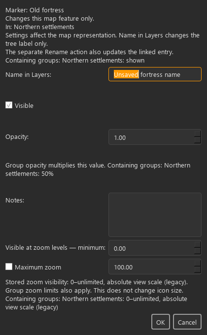
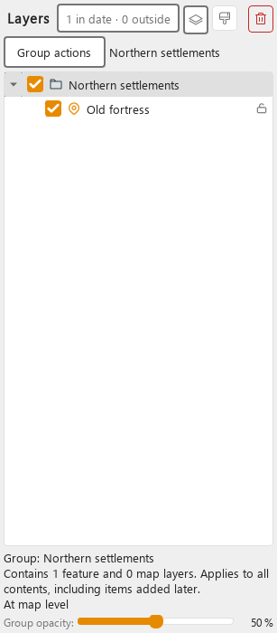
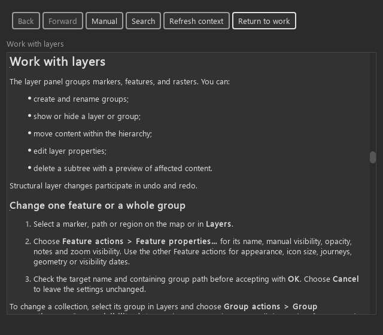

# KRT-140 — Explicit map settings ownership

Implemented in the uncommitted development worktree on 2026-11-09. KRT-140
remains In Progress. Human acceptance and native Windows DPI verification are
pending; automated and rendered evidence do not establish reduced cognitive load.

## Behavior and ownership

Feature actions now owns Feature properties across canvas, toolbar and Layers
routes. Groups expose Group actions; rasters and the base map name their own
settings routes. The reused modeless properties and date editors identify their
target and scope. The Layers opacity control names the active target and is
disabled for locked features or absent targets.

Group captions count descendant features and map surfaces, including hidden
items, and retain their collective scope with zero or one feature. Feature
captions show the containing group path. Ancestor opacity, manual visibility,
zoom limits and date values are explained without providing an inheritance
override. Icon size while zooming remains distinct from zoom visibility.
Group dates continue to affect vector features only.

Commands, storage, temporal resolution and inheritance remain unchanged.
Untouched zoom values retain their stored precision and legacy zoom basis.
Name in Layers changes only the tree label; the separate Rename action retains
existing marker and linked-record synchronization. Canvas
selection mirrors the corresponding Layers target without opening an inspector.

## Contracts and evidence

Authoring contracts 1–9 apply: ordinary settings reuse existing modeless editors;
specialized editors retain their established behavior. Shared secondary actions,
supporting captions, standard multiline input styling and semantic focus roles
provide the presentation. No authored map colors or visual-policy exceptions
were changed. Escape cancels the innermost menu/editor; accepted changes retain
existing commands and undo boundaries. Target guards reject stale editor results.

The focused regressions cover ownership, shared menu dispatch, scope counts,
hidden and locked targets, modeless target changes, map context, opacity,
temporal inheritance and persistence/undo integration. The render matrix covers
all six themes at 420/760 px dialog widths and 300/480 px panel widths, including
focus, disabled opacity and theme changes with retained draft text/selection.
Offscreen renders use Windows Segoe UI at device pixel ratio 1.0.
The generated map.layers Help was also captured at 360/640 px in all six themes;
the normal and narrow routes were visually inspected. The retained matrices are
listed in [capture metadata](renders/captures.json) and
[Help presentation metadata](help-renders/presentation.json).

Validation on 2026-11-09: 319 distinct focused regressions passed across the
primary batch and targeted recheck (the initial batch's sole remaining failure
was a reviewed Help fingerprint, corrected before its successful rerun).
Focused Ruff, repository-wide mypy (649 source files), visual policy,
complexity policy, Help inspection, offline Help generation and strict Sphinx
passed. No reviewed complexity hotspots or baseline exceptions changed.

| Documentation review field | Record |
| --- | --- |
| Reader and purpose | Map authors choosing between one feature and a collection; how-to |
| Canonical page and release | Maps guide and map.layers/map.appearance/map.visibility; Unreleased |
| Source identity | cf074014aa532eb346eb01782fbf7d07da2ef52e plus this uncommitted worktree |
| Sources reviewed | Shared feature actions, properties/date/size editors, layer panel, existing property and rename commands |
| Anchors and integration | Existing task/excerpt anchors retained; new properties/group action bindings; indexed evidence page |
| Rendered review | Offscreen production QSS, narrow properties and group scope; repaired multiline notes styling |
| Human/live Help/reader approval | Pending; no participant or native-DPI claims |







Reproduce the render matrix with the shared pytest fixtures:

```powershell
$env:QT_QPA_PLATFORM = "offscreen"
$env:KRT140_EVIDENCE_DIR = "docs/ux/evidence/krt140/renders"
.venv\Scripts\python.exe -m pytest tests/unit/test_map_settings_scope.py -q
```

## Documentation review and human acceptance

Primary purpose: how-to, in the canonical Maps guide. Source review checks the
visible labels, acceptance/cancellation, independent settings, inherited effects,
rename synchronization and undo guidance. Existing Help anchors remain, including
the retired layer-properties anchor; new controls have dedicated inspection
bindings. Offline Help and strict Sphinx validation are recorded separately from
human reader performance.

Using the [documentation review form](../../../developer/documentation-review.md)
and [reader observation form](../../../developer/documentation-reader-testing.md),
human prose review, live Help review and unassisted reader testing remain pending.
For authoring acceptance, start from an empty world under KA-04/KA-20 rules:
create a map, put two features in a group, change only one feature, then change
the group. Repeat with a one-feature group and explain each setting's scope
before applying it. Verify the saved results and Undo independently. Record
misunderstandings, assistance and unintended sibling changes; do not report
automated checks as human acceptance.
