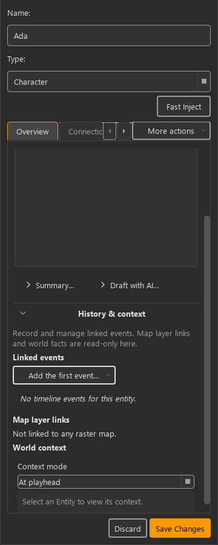
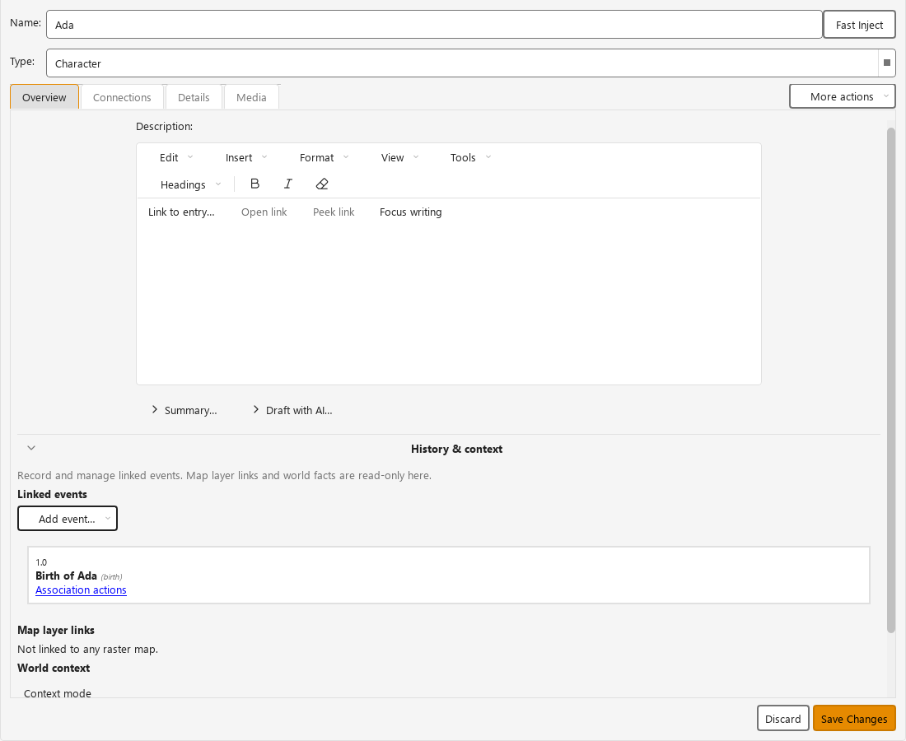
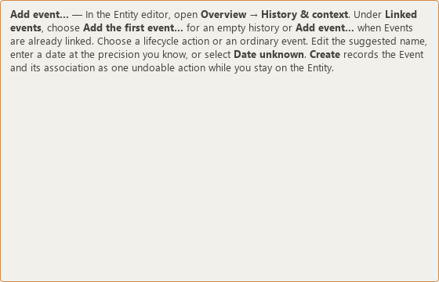

# KRT-146 — Visible lifecycle authoring in Linked events

Verified on 2026-11-09 in the uncommitted development worktree. This records the
repair of the visible authoring route; it is not human acceptance or package/DPI
verification. KRT-146 remains In Progress.

## Problem and resulting behavior

The composed Entity inspector hid the old Timeline container and moved only its
display into Overview. Newly added lifecycle buttons remained in that hidden
container. An `isHidden()` check passed even though the button's hidden ancestor
made it unreachable. The owner supplied a screenshot showing the missing route;
offscreen diagnostics reproduced it at 360 and 1100 px.

Overview → History & context now contains one Linked events component: a labeled
heading, one contextual creation action, living-status evidence and Event cards.
Empty histories offer **Add the first event…**; populated histories offer
**Add event…**. Both menus create or link Events. Unknown/custom Entity types
offer **Ordinary event…** directly. The retired Timeline container and disclosure
are removed. The Event picker anchors to the visible action.

The caption distinguishes editable Event associations from read-only map/world
information. Opening the history disclosure or menu does not save data. Creation,
linking and association commands retain the existing worker and undo paths.

## Contract and implementation review

Contracts 1/2/5/6/7/8/9/11 apply. Controls use shared secondary action styling,
Phosphor menu cues and OverflowToolBar reflow. Event colors continue to indicate
Event identity; no new colors, local variants or policy exceptions were added.
History & context remains the outer disclosure. Tab from that heading enters the
active creation action through the component's focus proxy; Space opens its menu.
Enter selects a menu item. Escape cancels the innermost menu/picker.

Regression checks retain unsaved prose, text selection, selected Entity and
playhead across theme changes and disclosure cycles. Existing-Event selection
emits the normal command intent; cancellation leaves the draft intact. Normal
document scrolling continues to own the cards without adding nested scrolling.

## Automated evidence

- The initial behavior batch passed 207 editor, presentation, coordinator,
  chronological-card, lifecycle and timing-history tests. After tightening Tab
  traversal and the generic Entity route, the affected editor/composition/Help
  batch passed 110 tests. These batches overlap and are not summed.
- Two additional tests passed for Inspect control on the empty/populated actions.
- Repository-wide mypy passed for 648 source files; focused Ruff, Help inspection,
  visual policy and complexity policy checks passed.
- Offline Help generation and strict Sphinx passed. Existing inspection IDs and
  excerpt anchors were retained; only reviewed source mappings/fingerprints moved.
- [Capture metadata](renders/captures.json) records 24 empty/populated captures
  over six themes and 360/1100 px widths, plus disabled and offline Help renders.
  The Windows fonts are explicitly loaded for the offscreen renderer. Device
  pixel ratio is 1.0; this does not establish native Windows scaling behavior.
- Search for “Add the first event” returns `help-lifecycle-event` first.

Reproduce the captures using the existing Qt test fixtures:

```powershell
$env:QT_QPA_PLATFORM = "offscreen"
.\.venv\Scripts\python.exe -m docs.ux.evidence.krt146.capture_visible_history
```







## Documentation review and acceptance boundary

This is a reference correction for authors using the current development version.
The canonical page is `docs/user/events-entities-relations.md`, topic
`authoring.details`, excerpt `help-lifecycle-event`. The former Timeline excerpt
anchor remains available and now explains Linked events and the outer disclosure.
Source review traced the component, composition, coordinator, commands and tests.
Rendered review checked readable labels, the visible empty/populated routes and
the corrected offline Help paragraph. No new manual task semantics were added.

Human prose/live Help approval, native Windows DPI/text scaling and the unaided
discovery/authoring-effort comparison remain pending. The owner screenshot is
evidence of the original failure, not acceptance of the repaired interaction.
Reader follow-up: from a fresh Entity, find and record a historical Event without
coaching; separately repeat using Help, noting completion, wrong turns, assistance,
time and errors. Preserve advanced timing and relation tasks KA-08/10/19/20 from
the existing benchmark when comparing authoring effort.
